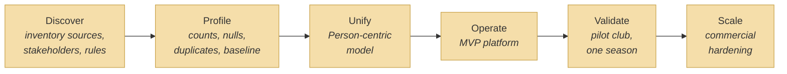
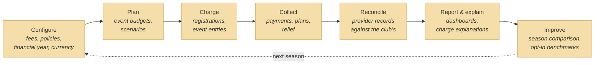

# Value Stream

_[← Strategy layer](./README.md) · [EA home](../README.md)_

**ArchiMate elements:** Value Stream, Value Stream Stage.

## Deliver a trustworthy multiclub football administration platform

Six stages, matching the project's roadmap phases. Each stage names the
capabilities ([2_capabilities-and-resources.md](./2_capabilities-and-resources.md))
it exercises.

| Stage | Delivers | Capabilities exercised |
| ----- | -------- | ------------------------ |
| **Discover** | Source inventory, stakeholder map, current processes, fee schedules, per-season rules, official source of record per data item | C9 |
| **Profile** | Row counts, null/duplicate rates, season-over-season comparison, payment and referee analysis, a quality baseline | C6, C9 |
| **Unify** | The Person-centric model: identity, roles, seasons, registrations, payments, documents, referees, competitions, matches, appointments, history | C1, C2, C4, C11 |
| **Operate** | The MVP platform itself: portal, auth, multitenancy, registration, documents, finance, referee management, competitions & calendar, calendar feeds for referees, dashboards, transactional email, audit | C1–C8, C10, C11, C13 |
| **Validate** | A controlled pilot on one club and one season (or controlled group), compared against the club's prior process, with time and error measurements and feedback incorporated | C2–C9 |
| **Scale** | Hardening, backups, monitoring, privacy/security review, contracts, pricing, onboarding, support material — the transition to a commercial, multi-club product | C10 |

**Target:** the platform is live for the pilot club (Operate → Validate
complete) before the end of Q4 2026 (Goal G6,
[1_motivation.md](./1_motivation.md)); Scale follows once the pilot
validates the approach.

**Deferred capability:** C12 (Carnival & event management, Goal G7) is
architected in this value stream's Unify/Operate shape but not built for
the Q4 2026 MVP — see the adopted interpretation in
[2_capabilities-and-resources.md](./2_capabilities-and-resources.md)'s
Courses of action. It joins the platform in a later initiative once
C1–C11 are live.

## Run a club's money with every figure explained

Added November 2026 for Goal **G9**
([scope 134](../../scope/134_pitchpeople_financial_intelligence.md)). The
stream above is how the *platform* is delivered; this one is how a *club*
gets value from its finance once it is live. It is a cycle a season turns
once: what was learned in **Improve** sets next season's **Configure**.

| Stage | Delivers | Capabilities exercised | Built today |
| ----- | -------- | ---------------------- | ----------- |
| **Configure** | The club's fee schedule and terms, governing-body charges, the policies that apply to it, its financial year and its currency | C3, C23 | Fee schedule and terms ([scope 130](../../scope/130_the_clubs_fee_schedule.md)); **no** policy versions, financial year or currency |
| **Plan** | An event's budget and its sanctioning estimate, before the club commits; scenarios compared; a forecast to the season's and financial year's end (BR220) | C22, C26 | **Nothing** |
| **Charge** | What each family and each event entrant owes, priced from the schedule and kept as history | C3, C22 | Registrations priced and the pricing kept ([scope 131](../../scope/131_every_registration_priced_from_the_schedule.md)); **no** event charges |
| **Collect** | Payments, payment plans, voucher and hardship relief | C3, C24 | Recorded by hand (BR77), plans (BR74–BR76), vouchers (BR81), hardship (BR164); **no** provider |
| **Reconcile** | The club's records matched to what a provider or bank confirms, with exceptions for a person | C24 | **Nothing** |
| **Report & explain** | Role dashboards; every figure with its basis, period, currency and as-at (BR143); every charge with the policy version behind it | C8, C23 | The finance report across seasons ([scope 133](../../scope/133_the_finance_report.md)) and the arrears view ([scope 48](../../scope/48_arrears_visibility_wwcc_reminders_and_the_administrator_constraint.md)) |
| **Improve** | Season-on-season comparison, financial health indicators (BR221) and, for a club that opted in, anonymised benchmarks | C8, C25, C26 | Season comparison (scope 133); **no** benchmarking |
