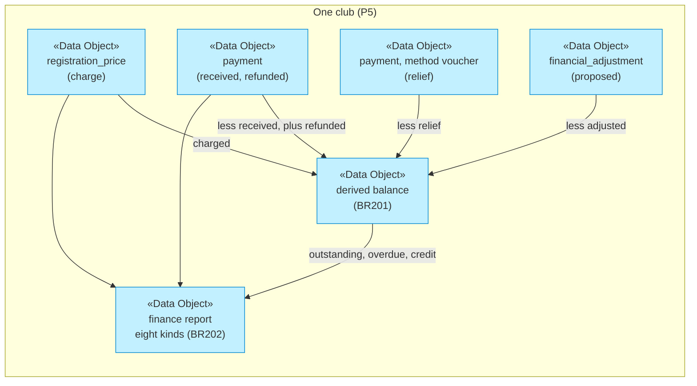
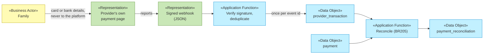
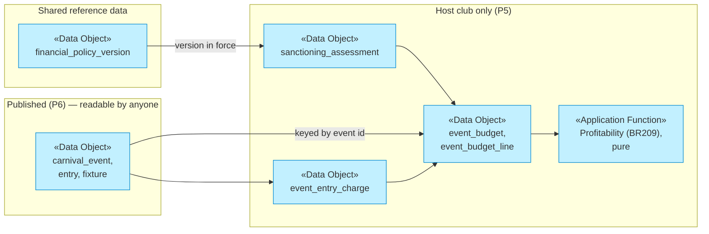
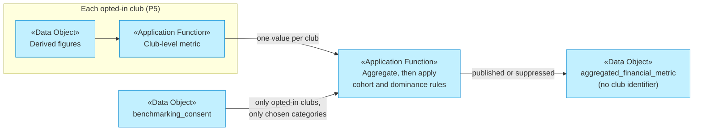

# Data Flows

_[← Information layer](./README.md) · [EA home](../README.md)_

**ArchiMate elements:** Data Object, Representation, Flow, Access.

How information moves between representations and across boundaries.
**Opened November 2026 by [scope 134](../../scope/134_pitchpeople_financial_intelligence.md)
and so far covers only the financial flows**; the flows of earlier slices
are described beside their [data objects](./1_data-objects.md). Every flow
below is **Pending** unless a row says otherwise.

Two boundaries matter more than any arrow: the **tenant boundary** (P5),
which only P6's published events and P8's grants and aggregates may
cross, and the **provider boundary**, across which money moves and the
platform receives only evidence of it (decisions
[16](../../decisions/16_the_platform_records_a_payout_a_provider_moves_it.md)
and [20](../../decisions/20_payments_through_a_provider_port_never_on_the_platform.md)).

## 1. From a charge to a balance



| | Today | Target |
| - | ----- | ------ |
| The balance | `registration.outstanding_amount_cents`, a typed running balance: moved by `app_record_payment` with each receipt (0103, which fixed a treasurer's payment leaving it unmoved) and overwritten by `setOutstandingAmount` | Derived from the four sources above, by one database function both the screens and the report call |
| *Collected* in the report | Every `payment` row, relief and adjustments included | *Received* (money only) apart from *relief*, *adjusted* and *refunded* |
| Currency | Implicit AUD everywhere | The club's recorded currency on every figure; no cross-currency arithmetic (BR200) |

## 2. A collection through a provider



The family's card or bank details travel **only to the provider** (BR207).
What returns is evidence: a provider reference, an amount, a currency, a
status, sometimes the payer's name and email. The webhook body is verified
before it is parsed (BR206) and kept as a `provider_event` for a short
period, while the parsed `provider_transaction` is kept for seven years from
the end of the financial year. A bank statement import takes the same path
from a file the treasurer uploads, with the file in place of the signature
as the evidence of origin.

Outbound — a referee batch, a referral payout — runs the other way through
the same port, and stays a **simulation** until a provider is approved and
tested.

## 3. An event's money



**The arrow that must never exist runs from HOST to PUBLIC.** The public
policy on the carnival tables publishes every column of a published event,
so a budget figure on those tables would be published with the draw. The
financial tables reference the event; the event references none of them,
and a test asserts that no financial column appears on the three public
tables — the same assertion BR139's test makes for `person_id`.

## 4. A governing body: policies in, granted reports out

```mermaid
flowchart LR
  gb["«Business Actor»<br>Governing body"]:::business
  pol["«Data Object»<br>financial_policy_version,<br>transparency_report<br>(reference)"]:::application
  club["«Data Object»<br>A club's<br>club-level figures"]:::application
  grant["«Data Object»<br>governing_body_access_grant"]:::application
  fn["«Application Function»<br>Scoped read, checks<br>the grant every call"]:::application
  log["«Data Object»<br>governing_body_access_log"]:::application

  gb -->|publishes| pol
  pol -->|read by every club| club
  club --> fn
  grant -->|purpose, categories,<br>period, expiry| fn
  fn -->|club-level only (BR215)| gb
  fn --> log

  classDef business fill:#fffbb5,stroke:#b8a200,color:#333
  classDef application fill:#c2f0ff,stroke:#0288d1,color:#333
```

Inbound is reference data and crosses no tenant boundary. Outbound is the
P8 exception, and only through the function, which refuses a read with no
live grant and writes the log in the same transaction. **Permitted by P8.**

## 5. Benchmarking



No row leaves a club: only a club-level value, computed by the same
functions the club's own dashboards use, and only for a club with a live
consent. The aggregate keeps the cohort's size and never its members.
**Permitted by P8.**

## 6. The Assistant

Figures flow **to** the Assistant, already computed and labelled with their
basis, period, currency and as-at moment; a draft flows **from** it to a
person, who uses or dismisses it (`AssistantNote.tsx`). Nothing flows from
the Assistant into a financial table (BR218). No family-level or
minor-level financial data reaches an uncontrolled AI service (P4), and
today no model is called at all (`scripts/check_assistant.py`).

## 7. Forecasts and health indicators

Read-only, and computed rather than kept. The same derived figures the
dashboards show (flow 1) feed `src/domain/finance/forecast.ts` and
`health.ts`, together with the instalments still due under live plans, the
club's own collection history by age of debt (live seasons and imported
ones alike, scope 132), and approved event budgets (flow 3). What comes out
carries its method, inputs, horizon and as-at moment, and **nothing flows
back**: a forecast never becomes a stored figure (BR220), and an indicator
never becomes a grade (BR221).

