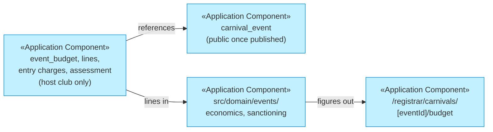
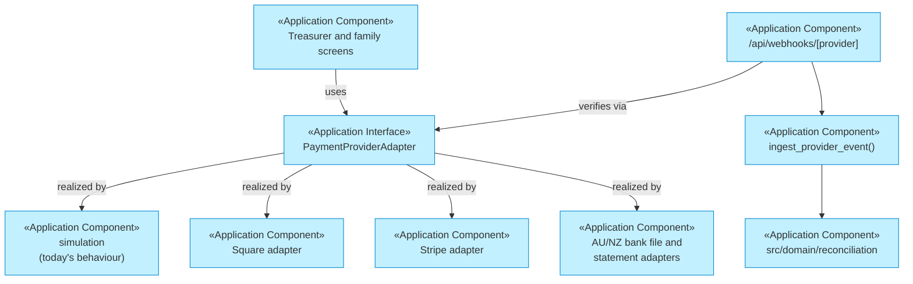
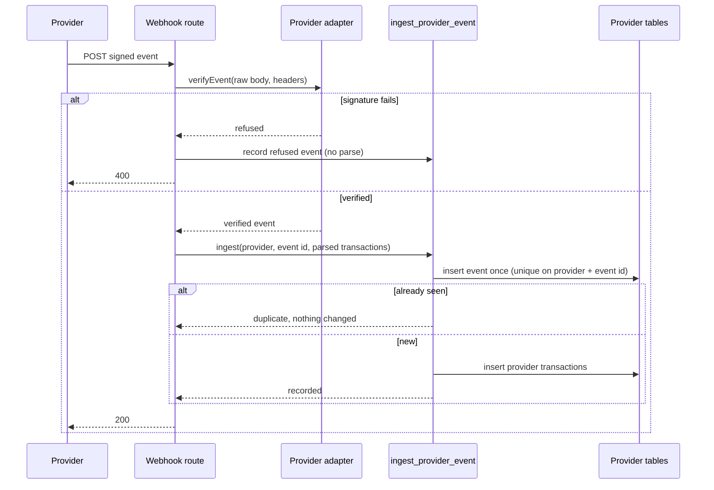

# Solution Design

_[← Application layer](./README.md) · [EA home](../README.md)_

**ArchiMate elements:** Application Component, Application Interface,
Application Collaboration.

**Opened November 2026 by [scope 134](../../scope/134_pitchpeople_financial_intelligence.md),
and so far it covers only the financial design.** The rest of the
application's structure is in [2_application-components.md](./2_application-components.md)
and its three structural rules, and the cross-cutting design in
[docs/spec/design.md](../../spec/design.md). Interaction sequences live here
until there are enough of them to need a collaborations document.
**Everything below is Pending** — designed, not built.

## 1. Where the money logic lives

The same layering every slice uses, with one rule added for money: **a
figure is computed once, in one place, and every screen and summary reads
that one computation.** Scope 133's report and the registration detail page
disagreeing about a balance is the failure this design is built against.

| Concern | Layer | Why there |
| ------- | ----- | --------- |
| Money arithmetic, currency guards, the derived balance, event economics, sanctioning, reconciliation matching, cohort suppression | `src/domain/` — pure | Deterministic and exhaustively testable by `node --test` with no database (P3, BR209). The second `typecheck` pass keeps it free of I/O |
| What a screen decides: which kind a figure is, which metric a role sees, whether a scenario differs | `src/web/` — pure | Tested the same way; the `.tsx` renders the decision |
| Provider calls, webhook verification, secrets, queries | `src/data/` | The only layer allowed I/O. Every service-role use names its reason |
| Constraints that must hold against any writer — append-only ledgers, the balance function, the grant check, the public-column guard | `supabase/migrations/` | BR74's lesson: a rule only the application enforces is a rule the next writer skips |

**The six domains share one foundation rather than six ledgers.** Club
Finance, Event Economics, Payment Services, Financial Governance, Financial
Intelligence and Benchmarking ([capabilities](../1_strategy/2_capabilities-and-resources.md#financial-intelligence-as-six-connected-domains))
each read the **shared financial services** — `Money` with its currency, the
derived balance and its eight kinds of figure, the club's financial year,
and the refusing, base-stating metric shape — and none keeps a figure of its
own. A domain is a boundary in the code's folders and the docs, not a
service or a database: one Next.js application, one Postgres, one tenancy
model. Splitting them into deployables would buy nothing at one club's
volume and would put a network call between two numbers that must agree.

## 2. The ledger: one derived balance

`registration.outstanding_amount_cents` stops being written. A migration
adds `app_registration_balance(registration)` — a `security definer`
function that computes BR201 from the latest `registration_price`, `payment`
(by method and kind), and `financial_adjustment` — and the existing money
function `app_registration_money()` returns its result instead of the
column. `src/domain/finance/ledger.ts` mirrors the same arithmetic for
tests and previews, and a suite asserts the two agree on the same inputs.

Two consequences are deliberate. **The treasurer-payment defect is gone at
its cause**: WP1a (migration 0103) already fixed the symptom by writing the
payment and the balance in one function, and with nothing writing the column
there is no second write left to go wrong.
**`setOutstandingAmount` is retired**: what it did becomes either a
re-pricing (0100) or a recorded adjustment (BR203).

**Migration is a reconciliation, not an overwrite.** Before the column is
retired, one read-only function lists every registration whose column
differs from the derived figure, and those differences are reviewed by the
treasurer on DEV before anything changes. A difference is a fact about the
club's history; resolving it silently would be the failure BR201 exists to
prevent.

## 3. Event economics, beside the event

**Decision A, and the constraint that shapes it.** There is one event
entity, `carnival_event`, and its money lives in host-club-only tables that
reference it. The money cannot be columns on the event: the policy
`carnival_event_select_public` (0034) publishes every column of a published
event to anyone. A test asserts, against `information_schema`, that none of
the three public carnival tables carries a financial column — the same way
suite 37 asserts they carry no `person_id` (BR139).

**The calculator is a pure function of lines.** Each line is revenue or
expense with a unit — fixed, per day, per team, per participant, or per
participant per day — expected and actual amounts, and a basis (BR208). The
event's days *d* and teams *t* are inputs, so per-day lines become fixed
(× *d*), per-team lines fixed for a stated *t*, and per-participant-per-day
lines per-participant (× *d*). For a participant count *n*: revenue(*n*) =
Σ fixed revenue + *n* × Σ per-participant revenue, and likewise for cost,
the sanctioning charge being one cost line whose amount the sanctioning
calculator supplies. A carnival charged per team states break-even in
teams instead, by the same arithmetic.
Break-even is the smallest integer *n* ≥ 0 with revenue(*n*) ≥ cost(*n*);
when the per-participant contribution is zero or negative and fixed cost
exceeds fixed revenue, it is *not reachable* (BR209). Thresholds in a
policy (a charge that changes above a participant count) make cost(*n*)
piecewise, so break-even is found by evaluating each segment rather than by
one division — which is why the function takes the policy's rule lines, not
a single rate.

**Scenarios** are the same calculation over a copy of the lines with named
changes, stored only when adopted (BR212).

**The public event calculator is the same function, with nothing around
it** (BR222, WP2a). `/event-calculator` is a prerendered page whose one
client component imports `src/domain/events/economics.ts` and computes in
the visitor's browser: no server action, no route handler, no database
call, no storage. Presets per event type (carnival, holiday clinic,
tournament) only pre-fill lines the visitor can change; none is a
governing body's amount (BR211). Because it is the same function, a club
that later signs in and builds a budget from the same lines gets the same
answer — the property the product owner asked for.

## 4. Payments through a port

**Collections and payouts are separate capabilities**, declared per
adapter, so an adapter that cannot pay out simply has no payout method and
no screen offers one. Square and Stripe are candidates, not commitments
([decision 20](../../decisions/20_payments_through_a_provider_port_never_on_the_platform.md));
the **simulation adapter** is today's `app_simulate_batch_payout()`
behaviour behind the same interface, kept until a real adapter is approved
and tested, and refused in production once one is.

### A webhook, in sequence

The *webhook route* is `src/app/api/webhooks/[provider]/route.ts`, the
*provider adapter* lives in `src/data/payments/`, and the *provider tables*
are `provider_event` and `provider_transaction`. The route reads the raw body with `request.text()` before anything parses
it, because a signature is computed over bytes — the pattern the installed
Next.js guide gives for webhooks. It has no signed-in user, so it calls
**one** definer function through a new `createAdminClient('provider-webhook')`
reason, and that function resolves the club from the provider account the
event names, **never** from anything else in the request. Matching runs
after ingestion, in the same function or the next scheduled sweep, and
never decides an exception.

### Adding a payment provider adapter

1. **Assess it first.** Record what it can collect, refund and pay out, in
   which currencies, with what fees, and how it signs events — in the
   [payout providers annex](../../annexes/payout-providers.md), extended to
   collections. An operation the provider does not offer is absent from
   the adapter, not stubbed.
2. **Implement `PaymentProviderAdapter`** in `src/data/payments/<provider>.ts`,
   reading its secrets from server-side configuration only, and add its
   names to the deployment configuration table.
3. **Use the platform's own record id as the idempotency key** on every
   call, so a retry cannot pay or collect twice.
4. **Add its mapping** from provider events to `provider_transaction`
   inputs as a pure function under `src/domain/payments/`, tested against
   the provider's documented examples.
5. **Add the provider value** to the check constraints that list providers
   — a new migration, never an edit.
6. **Prove it in a sandbox** account before any club connects a live one,
   and keep the simulation available in development.

## 5. A governing body reads through a grant

A governing-body user holds no `club_membership` and is not a member of the
club. They read through one definer function, `app_governing_body_read()`,
which on every call checks a live grant for that association, purpose and
category, returns club-level figures only, and writes the access log in the
same transaction. There is no table policy that admits them and no
service-role path, so a missing check returns nothing rather than
everything — the property RLS gives every other read (P5). **Within P8 and [decision 19](../../decisions/19_a_club_grants_what_a_governing_body_reads.md).**

## 6. Benchmarks are computed, not queried

`app_run_benchmarks()`, a scheduled definer function, asks each opted-in
club's own functions for its club-level metric, pools the values, applies
the cohort and dominance rules (`src/domain/benchmarking/suppression.ts`,
mirrored in SQL and tested to agree), and writes only the result. A club
reads the cohort figure beside its own. No function returns another club's
value, and the result table has nothing to join back to a club.
**Within P8 and [decision 21](../../decisions/21_benchmarking_is_opt_in_and_never_identifies_a_club.md).**

## 7. Forecasts are arithmetic, not predictions

`src/domain/finance/forecast.ts` projects to a stated horizon from three
inputs only: instalments still due under live plans, outstanding balances
weighted by the club's own historical collection rate for debt of that age
(live and imported seasons alike), and approved event budgets' expected
lines. The method is the output's first field, so a screen and the Assistant
can say *how* the number was made (BR220). With fewer than two seasons of
history the collection-rate input is absent and the forecast says so rather
than assuming one. `health.ts` returns the named indicators of BR221, each
with its formula, and no total.

## 8. Deliberately not designed

- **Accounting.** No general ledger, chart of accounts, journal or BAS. An
  export to the club's accounting software is a later integration (Xero is
  the named candidate), not part of this design.
- **Statistical or machine-learned forecasting.** BR220's projection is
  arithmetic over the club's own records; a model's forecast is out of scope.
- **Currency conversion.** No exchange rates are held. BR200 says what a
  conversion would have to record; nothing converts.
- **Tax computation beyond the club's statement.** A GST component is
  computed only where the club has said a line includes GST (BR219).
