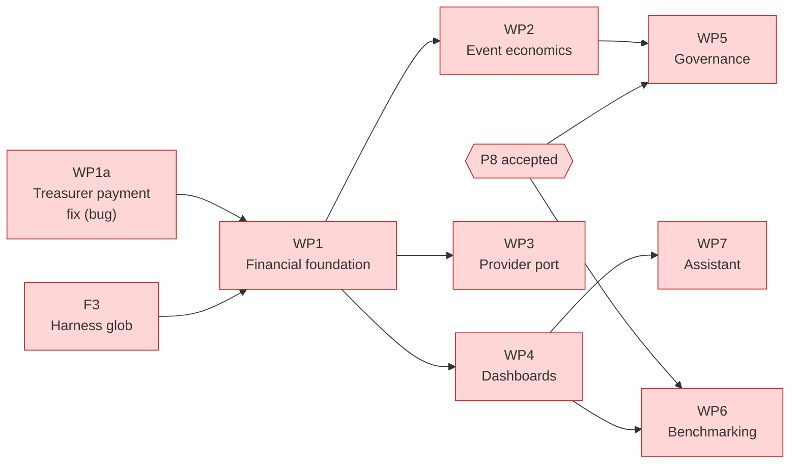

# Project Scope — PitchPeople Financial Intelligence: Integrated Financial Management, Event Economics and Governance

_[← Scope index](./README.md) · [EA home](../ea/README.md)_

**ArchiMate viewpoint:** Implementation & Migration.
**Delivered as:** branch `claude/funny-thompson-ncu476`. **Stages 1–3 only:
discovery, architecture and this scope. No code, no migration and no test
has been written. Implementation (Stage 5) waits for the review in Stage 4.**

On 4 November 2026 the product owner asked for PitchPeople to grow from
registration and administration into a **connected financial intelligence
platform** for clubs, academies and, progressively, governing bodies in
Australia and New Zealand. Four architectural decisions came approved with
the request (below). This document records what discovery found already
exists, the architecture the five EA layers now describe, the work packages
that would build it, and what is still undecided.

> **PitchPeople Financial Intelligence helps football organisations
> understand, manage and improve their financial position through connected
> financial management, transparent policies, payment integration and
> actionable insights.** It is an integrated capability within PitchPeople —
> not a parallel accounting application, not a replacement for registration,
> and not a weakening of any club's financial privacy.

## The confirmed decisions

| | Decision | Where it now lives |
| - | -------- | ------------------ |
| **A** | **Event economics is integrated into the existing carnival and event management** — no second event entity. Budgets, revenue, expenses, sanctioning and profitability extend the existing event lifecycle | C22; [solution design §3](../ea/4_application/4_solution-design.md#3-event-economics-beside-the-event). Discovery adds one constraint: the money must live *beside* `carnival_event`, because that table's public policy publishes every column of a published event |
| **B** | **Clubs first, governing bodies progressively.** No automatic access to club financial records; access explicit, authorised, auditable, purpose-limited | Principle **P8**(a), accepted 4 November 2026; [decision 19](../decisions/19_a_club_grants_what_a_governing_body_reads.md) (Accepted); BR214, BR215 |
| **C** | **Provider-agnostic payments.** An adapter architecture for Square, Stripe and AU/NZ bank mechanisms; collections and payouts separate; the platform records, a provider moves money; no card data; secrets server-side; simulated payouts kept until a real provider is approved and tested | C24; [decision 20](../decisions/20_payments_through_a_provider_port_never_on_the_platform.md) (Accepted); BR204–BR207 |
| **D** | **Opt-in benchmarking**, anonymised and aggregated, with thresholds and small-cohort suppression; never a way round tenant isolation | Principle **P8**(b), accepted 4 November 2026; [decision 21](../decisions/21_benchmarking_is_opt_in_and_never_identifies_a_club.md) (Accepted); BR217 |

**One conflict was surfaced, and the product owner resolved it.** Decisions B and D both
put club financial information across a tenant boundary, which Principle
**P5** forbids without a named exception ([decision 3](../decisions/3_public-event-data-crosses-tenant-isolation.md)'s
rule). This scope proposed **P8** as P5's second scoped exception, and the
product owner **accepted it on 4 November 2026** ([#121](./open-questions.md)).
It permits those two exceptions and nothing else; Releases 1 and 2 do not
cross P5 at all.

## Business context

PitchPeople already holds a club's registration money: a fee schedule
priced per team and age band with a sibling discount (scopes 130–131),
payment plans, vouchers, hardship, arrears across seasons, referee claims
and batches, sponsor invoices, and a finance report across every season the
club holds (scope 133). Its clubs are volunteer-run, report to a committee
and an AGM, and pay governing bodies registration fees, levies and — with
Football Queensland's October 2026 Sanctioning Policy — charges per event
participant.

## Problem statement

A club cannot answer, in one place and at the moment it matters, *what is
our financial position, and why?* Today:

- **The balance cannot be trusted.** It is a running column, typed or
  updated by application code — and a payment recorded by a treasurer who
  is not also an administrator **leaves it unchanged** (reproduced, below).
- **Different kinds of money read as one.** A voucher's relief and a
  write-off booked as an `adjustment` both count as *collected*.
- **Every amount is assumed to be AUD**, and nothing records a financial year
  or a GST treatment, though retention already counts from a financial year.
- **An event is committed to before anyone knows whether it pays.** A
  carnival has dates, a venue and a draw, and no budget, entry fee,
  sanctioning estimate or profitability.
- **A governing-body charge is a number without a basis** a club can check.
- **No money moves through the platform**, so collection is visible only
  when a treasurer types it in, and nothing reconciles.

## Objectives

1. A club can rely on its own figures: one derived balance, eight distinct
   kinds of figure, each in its currency (Release 1).
2. An events coordinator can see an event's viability — profit, cost and
   revenue per participant, break-even, scenarios — before the club commits
   (Release 1).
3. Collections and payouts move through approved providers and reconcile
   against the club's records, with every difference handed to a person
   (Release 2).
4. Every governing-body charge is explained by an identifiable, versioned
   policy, and a governing body can publish policies and receive what a club
   chooses to send (Release 3).
5. A club that opts in can compare itself with an anonymised cohort; the
   Assistant explains the figures without ever deciding anything (Release 4).

## Actors

All exist in [the actors table](../ea/2_business/1_business-actors-and-roles.md)
except where marked. The [role × financial-operation matrix](../ea/2_business/5_domain-context-and-rules.md#financial-operations-by-role)
says what each may do.

| Actor | Kind | Concern here |
| ----- | ---- | ------------ |
| President (`admin` access) | Human | The club's overall financial health, risks, event performance |
| Treasurer, Finance Admin (`treasurer`) | Human | Receipts, balances, arrears, adjustments, refunds, reconciliation, reports |
| Registrar | Human | Registration charges and payment status; assistance status only as authorised |
| Events Coordinator (an event's responsible person, BR29) | Human | Event budgets, entry revenue, costs, sanctioning estimates, profitability |
| Referee Coordinator (`coordinator`) | Human | Claims, approved payments, batches, remittances |
| Committee | Human | Resolutions: waivers above a threshold, budgets above a threshold, grants, benchmarking opt-in |
| Parent/Guardian, Player (18+) | Human | Their own charges, payments, plans and refunds (BR121) |
| **Payment Provider** — *new* | Organisation (external) | Moves money; its signed events are evidence, never instructions |
| **Governing Body Policy Administrator** — *new, prospective* | Human, external | Publishes policies, reads only under a club's grant (P8) |
| Assistant | AI — **advisory, unchanged** | Explains, summarises, flags, drafts (BR218); decides nothing |

## Capabilities

C22 **Event economics**, C23 **Financial governance & transparency**, C24
**Payment integration & reconciliation** and C25 **Financial benchmarking**
are new; C3 and C8 are extended; C12's event is reused. All are in
[2_capabilities-and-resources.md](../ea/1_strategy/2_capabilities-and-resources.md),
serving the new Goal **G9**.

## EA alignment (assessed top-down before implementing)

| Layer         | Impact |
| ------------- | ------ |
| 1_strategy    | **Changed.** Goal **G9**; two stakeholder rows (club financial officers; governing bodies as policy authors); **Principle P8** (accepted 4 November 2026) as P5's second scoped exception; capabilities **C22–C25**, with C3, C8 and C12 annotated; two resources (Football Queensland's Sanctioning Policy as an example of shape, unverified; payment provider capabilities); the Square resource restated per decision C; courses of action for the four releases, the two product experiences and the long-term vision; a second value stream (*Run a club's money*); positioning, traceability and five new claim boundaries in the value proposition |
| 2_business    | **Changed.** Actors: the Payment Provider and the prospective Governing Body Policy Administrator; the Assistant's finance decision rights listed (autonomy unchanged — advisory); two stale Majestri cells corrected. Services: four proposed services; the Player finance row corrected and the defect recorded. Five proposed processes. A *Financial intelligence* section of business objects (built-but-unlisted and proposed). Seventeen glossary terms. **BR200–BR219 proposed.** A role × financial-operation matrix |
| 3_information | **Changed.** The finance tables built since scope 76 that the data objects never listed; the running-balance defect recorded; **all 26 candidate objects assessed** against the schema (reuse, extend or new, with source, retention, access, audit, sensitivity). A new [data flows](../ea/3_information/2_data-flows.md) document for the financial flows. Two classes and a sharpened one in [data architecture](../ea/3_information/3_data-architecture.md), and the retention rows the schedule still needs |
| 4_application | **Changed.** Eleven proposed application services; seventeen planned components with intended paths; a new [solution design](../ea/4_application/4_solution-design.md) (the ledger, event economics beside the event, the provider port, webhooks, the adapter recipe, grant-scoped reads, benchmarks); a new [interface contracts](../ea/4_application/5_interface-contracts.md) document |
| 5_technology  | **Changed, no new infrastructure.** Supabase, Next.js Route Handlers and Vercel Cron cover every need; one new `createAdminClient` reason (`provider-webhook`); planned secrets and a `PAYMENTS_MODE` setting that refuses the simulation in production; Supabase Vault for per-club provider tokens; two `check_rls.py` exemptions to argue. What would justify a queue is named |

## Stage 1 — what discovery found

### The capability gap matrix

Verified against the code, migrations and tests on this branch's base
(`587ced1`), not against intent. **Status:** *Tested* — fully implemented and
tested · *Incomplete* — implemented, a named part missing · *Documented* —
designed in `docs/`, no code · *Absent* — neither · *Re-architect* — needs an
architectural change before it can be built.

| # | Capability | Status | Evidence | Gap |
| - | ---------- | ------ | -------- | --- |
| 1 | Registration pricing | **Tested**; *Incomplete* at checkout | `src/web/registration-price.ts` (+ tests); 0100 `registration_breakdown`, trigger `registration_priced_from_the_schedule`; `supabase/tests/98_*`; BR195 | The family's form shows no breakdown and asks no acceptance of terms (scope 130 WP4, scope 131 gap note) |
| 2 | Club fee schedules | **Tested** | 0099 (`fee_line`, `fee_settings`, `registration_terms`), 0100 (`team_fee_line`); `/registrar/registration-fees`; `src/web/registration-fee-form.ts`; `supabase/tests/97_*`; BR196 | No GST treatment, no currency |
| 3 | Governing-body fees and levies | *Incomplete*; **Re-architect** | `fee_line.kind` ∈ {governing, levy}, typed per club per season (0099) | No source, version, effective dates or approval status; not authored by the governing body |
| 4 | Payments | *Incomplete* — **defect** | `payment` (0007), `recordPayment` (`src/data/finance.ts`), `supabase/tests/14_*`; BR77, BR78 | **A treasurer-only account's payment does not move the balance** (see below); entry by hand only |
| 5 | Refunds and reversals | *Incomplete* | Negative `payment` with `reverses_payment_id` (0007) | No refund kind or reason; refund and correction indistinguishable; no provider refund |
| 6 | Payment plans and instalments | **Tested** | 0007; `src/domain/finance/plan.ts`, `finance.test.ts`; `supabase/tests/14_*`; `PaymentPlanPanel.tsx`; 0068; BR74–BR76 | — |
| 7 | Outstanding balances | **Re-architect** | `registration.outstanding_amount_cents` (0001), written by `recordPayment` and overwritten by `setOutstandingAmount` (`src/data/queries.ts`), which `registration_manage` (0058) allows admin, registrar and IT manager; read through `app_registration_money()` (0070, 0077, 0088) | A typed running balance, not derived; the registrar may overwrite it although BR78 reserves money to admin and treasurer |
| 8 | Overdue amounts | *Incomplete* | `PlanState.arrearsCents` (`src/domain/finance/plan.ts`), `src/web/plan-view.ts` | Per plan only; no club-wide ageing |
| 9 | Arrears reporting | **Tested** | 0040 (`app_outstanding_balances`, `arrears_action`), `supabase/tests/41_*`, `/registrar/arrears`, `arrearsQueue` in `src/domain/reporting/summary.ts`; 0088 and `supabase/tests/88_*` (an earlier debt stops play) | — |
| 10 | Hardship arrangements | **Tested** | 0077 (`hardship_request`), `supabase/tests/77_*`, `src/app/me/_hardship/`, `src/data/hardship.ts`; BR164 | Read by deciders, registrar and family — confidentiality beyond that is [#131](./open-questions.md) |
| 11 | Voucher programmes | **Tested**; claims manual | 0008, 0029, 0049; `src/domain/finance/voucher.ts` (+ tests); `supabase/tests/15_*`, `50_*`; BR21, BR81 | Government claims (BR23, BR24) are a manual portal step; relief is counted as *collected* in reports |
| 12 | Waivers and adjustments | **Absent** | Only an `adjustment` payment method, or overwriting the balance | No authorised, categorised adjustment |
| 13 | Reimbursement tracking | **Absent** | BR152's *credit* choice is recorded, applied by hand | No club expense or volunteer reimbursement object |
| 14 | Referee claims and payment runs | **Tested**; payouts simulated | 0026, 0027, 0047, 0072–0076; `supabase/tests/29_*`, `30_*`, `48_*`, `72_*`, `73_*`; `/registrar/verification`, `/registrar/referee-payments`, `/registrar/fees`; [decision 16](../decisions/16_the_platform_records_a_payout_a_provider_moves_it.md) | No provider; every `referee_payout` is `simulation` |
| 15 | Sponsor and referral revenue | **Tested**; simulated | 0081–0086; `supabase/tests/81_*`, `83_*`, `85_*`, `86_*`; `src/web/sponsor-billing.ts` | Collections simulated; this is workspace advertising, not event sponsorship |
| 16 | Financial reporting by season | *Incomplete* | 0036 (`app_finance_summary`, `supabase/tests/39_*`); 0102 (`app_finance_report`, `app_finance_bills`, `supabase/tests/82_*`); `/registrar/reports`; `src/web/finance-report.ts` (+ 22 tests) | *Collected* includes relief and adjustments; *outstanding* reads the typed column; AUD hardcoded; no financial year; no export |
| 17 | Distinct kinds: charged, received, outstanding, overdue, refunded, adjusted, relief | *Incomplete* | 0102 has billed, collected, outstanding, credits | Refunded, adjusted and relief not separated |
| 18 | Currency (AUD/NZD) | **Absent**; **Re-architect** | Only `club_licence.currency` (0018, the platform's own licence); `formatMoney` prints `$` (`src/domain/finance/money.ts`); `src/web/finance-report.ts` formats AUD; `club.jurisdiction` (0001) | An NZ club would be shown AUD without an error |
| 19 | GST treatment | **Absent** | — | — |
| 20 | Club financial year | **Absent** | — | The [retention schedule](../annexes/retention-schedule.md) counts from it |
| 21 | Provider transaction fees | **Absent** | — | — |
| 22 | Carnival and event management | *Incomplete* | 0034 (`carnival_event`, `carnival_entry`, `carnival_fixture`), `supabase/tests/37_*`, `/registrar/carnivals`, `/events/[eventId]`, `src/domain/carnival/ladder.ts` | Carnivals only, marked work in progress (scope 125); BR28 unwired; BR29 enforced by role, not by the responsible person (`carnival_event_write`) |
| 23 | Event type, duration, participants, commercial classification | **Absent** | `carnival_event` holds name, dates, venue, conditions text, points | — |
| 24 | Event participant registration and eligibility | **Absent** | Entries are clubs and teams, deliberately with no person column (BR139) | Event-level participant counts, not people, are what charges need |
| 25 | Entry fees, event revenue, budgets, expenses | **Absent** | — | — |
| 26 | Sanctioning rules engine | **Absent** | — | — |
| 27 | Profitability, break-even, scenarios | **Absent** | — | — |
| 28 | Role financial dashboards | **Absent** | `/registrar` (scope 106) shows registration metrics; the committee workspace shows sponsor money only (`src/app/me/_workspaces/CommitteeWorkspace.tsx`) | President, treasurer, registrar, events coordinator, referee coordinator views |
| 29 | Basis and as-at on every metric | **Tested** for reports | BR142, BR143; 0036; `src/domain/reporting/summary.ts` | Period and currency not stated |
| 30 | Multi-season comparison | **Tested** | Scope 133 | Registration trends not yet |
| 31 | Committee governance and permissions | **Tested** | 0049, 0058, 0059, 0079, 0084, 0092; BR123, BR153, BR166, BR167, BR175 | — |
| 32 | Governing body as an actor | **Documented** (external, read-only) | `association` catalogue (0032), [decision 15](../decisions/15_the_competition_catalogue_is_shared_reference_data.md) | No accounts; no relationship but `club_competition` |
| 33 | Governing-body access to club information | **Re-architect** | P5; [#31](./open-questions.md) | P8 accepted; nothing built |
| 34 | Policy versions, publication, consultation, transparency reports | **Absent** | — | — |
| 35 | Inbound collections (Square) | **Documented** | The Square resource; technology services "deferred" | Nothing in `src/` calls a provider |
| 36 | Outbound payouts | *Incomplete* (simulation) | 0072 `app_simulate_batch_payout`, `referee_payout`; [payout annex](../annexes/payout-providers.md) | No real provider |
| 37 | Webhooks, signatures, idempotency | **Documented** (payouts only) | Payout annex | — |
| 38 | Bank file and statement import | **Documented** (ABA payouts) / **Absent** (statements) | Payout annex | — |
| 39 | Reconciliation engine | **Absent** | The [payment plan process](../ea/2_business/3_business-processes.md#payment-plan-process) diagram shows *paid via provider → reconciled*, which no code does | — |
| 40 | Provider credential management | **Documented** | Payout annex's variable names | — |
| 41 | Financial benchmarking | **Absent**; **Re-architect** | — | P8 accepted; nothing built |
| 42 | AI assistant | **Documented**, surface built | [Decision 1](../decisions/1_ai-assistant-autonomy-level.md); `src/app/_components/AssistantNote.tsx`; `scripts/check_assistant.py` forbids any model client | No model is called; financial drafting **Absent** |
| 43 | Tenant isolation of finance tables | **Tested** | `scripts/check_rls.py`; `scripts/test_rls.sh`; `supabase/tests/10_*` and each slice's suite | — |

### Findings that change the plan

**F1 — A treasurer's payment does not move the balance (defect, verified).**
`recordPayment` inserts the `payment` (allowed to admin and treasurer) and
then updates `registration.outstanding_amount_cents` in a second statement,
which `registration_manage` (0058) allows only to admin, registrar and IT
manager. For a treasurer who is not also an admin, Postgres updates zero
rows and Supabase reports no error. Reproduced on 4 November 2026 by
applying every migration to a throwaway Postgres 16 and replaying the two
statements as a `treasurer`-only account: **one payment recorded, the
balance still $120.00 after a $50.00 payment.** The Treasurer office maps to
`treasurer` access (0059), so this is the normal path, not an edge case. It
also affects voucher relief, which goes through `recordPayment`. Because
`app_finance_report` reads *collected* from `payment` and *outstanding* from
the column, the report can show a season that billed $120, collected $50 and
has $120 outstanding. **It is a pure bug fix and can ship ahead of this
initiative** (WP1a).

**F2 — Event money cannot be columns on the event.** `carnival_event_select_public`
(0034) grants `select` to `anon, authenticated` on every column of a
published event. Decision A holds — one event entity — but its budget,
charges and assessments must be separate host-club-only tables, with a test
that no financial column ever appears on the three public tables.

**F3 — The behavioural test harness has three free numbers.**
`scripts/test_rls.sh` globs `supabase/tests/[0-9][0-9]_*.sql`; 00 and 99 are
reserved and only 65, 74 and 76 are unused. A suite numbered `100_*` would be
**silently skipped** — the exact failure the harness's own comment records
for suite 30. The glob must widen, in its own commit, before any WP adds a
fourth suite.

**F4 — Documentation that had drifted**, corrected in this change: the
business services and application services said there was no treasurer's
screen; the data objects did not list `hardship_request`, the payout tables
or the sponsor tables; the Majestri comparison said C12 was not started.
**Not corrected here:** the root README says merging to `main` does not apply
a migration, while CLAUDE.md and the deployment document say it does. This
scope assumes the stricter reading — a merged migration may run against the
linked project — and the contradiction should be settled on its own.

## Functional requirements

Grouped by work package; each traces to a rule in the
[rules table](../ea/2_business/5_domain-context-and-rules.md#business-rules).

| # | Requirement | Rules | WP |
| - | ----------- | ----- | -- |
| FI-1 | A payment recorded by any role allowed to record one moves the balance, atomically, in one database call | BR77, BR78, BR201 | 1a |
| FI-2 | Every amount carries a currency; no operation combines two | BR200 | 1 |
| FI-3 | A club records its currency, financial-year start and GST registration; fee lines record GST treatment | BR219 | 1 |
| FI-4 | The balance is derived from charges, receipts, relief, adjustments and refunds; nothing sets it outright | BR201 | 1 |
| FI-5 | Waivers, write-offs, corrections and credits are recorded adjustments with category, reason and authoriser; a waiver above the club's threshold cites a committee resolution | BR203 | 1 |
| FI-6 | Refunds are their own kind, with a reason, distinct from corrections | BR204 | 1 |
| FI-7 | Reports and dashboards show charged, received, relief, adjusted, refunded, outstanding, overdue and credit separately, per season and per financial year, per currency | BR202, BR143 | 1, 4 |
| FI-8 | An outstanding-debt dashboard ages what is owed (current, 30, 60, 90+ days past due) and links each family to the arrears follow-up that exists | BR79, BR202 | 1 |
| FI-9 | An event records its type, duration, expected and actual participants (junior and senior), commercial classification and jurisdiction — beside the event, not on it | Decision A, BR208 | 2 |
| FI-10 | An event budget holds revenue and expense lines by category (venue, equipment, coaching, referees, insurance, marketing, administration, sanctioning, other; entry fees, sponsorship, other income), each fixed or per participant, expected and actual, with a basis | BR208 | 2 |
| FI-11 | Entry charges to participating clubs or teams are recorded per event, and their collection tracked (by hand until WP3) | BR201, BR202 | 2 |
| FI-12 | Profitability, revenue and cost per participant, and break-even participants are computed by one pure function | BR209 | 2 |
| FI-13 | Scenarios are evaluated side by side without changing the budget, and adopted by a person | BR212 | 2 |
| FI-14 | A sanctioning charge is computed from a versioned policy in force on the event's dates, or entered as a club assumption, and frozen with its version and inputs | BR210, BR211 | 2 |
| FI-15 | A budget is approved by the treasurer, or by committee resolution above the club's threshold | BR213 | 2 |
| FI-16 | A provider port with per-adapter capabilities; the simulation is one adapter | BR207 | 3 |
| FI-17 | The first approved adapter collects (and refunds, if supported) through the provider's own page | BR204, BR207 | 3 |
| FI-18 | Provider events are verified, recorded once, and turned into provider transactions | BR206 | 3 |
| FI-19 | Provider transactions are matched to club records; unmatched items are exceptions resolved by a person with a reason | BR205 | 3 |
| FI-20 | A bank statement can be imported and reconciled the same way | BR205 | 3 |
| FI-21 | Referee and referral payouts run through the port, still simulated until a payout provider is approved | Decision 16 | 3 |
| FI-22 | Role dashboards for president, treasurer, registrar, events coordinator and referee coordinator, each metric with basis, period, currency and as-at, each refusing a reader who may not have it | BR142, BR143 | 4 |
| FI-23 | Season-on-season and financial-year comparisons, and a spreadsheet export for the admin and treasurer | BR143 | 4 |
| FI-24 | A policy register: versions with source, jurisdiction, dates and approval status; charge explanations line by line | BR210, BR211 | 5 |
| FI-25 | Clarification and exemption requests, responses and decisions, append-only | BR123 | 5 |
| FI-26 | A financial return the club generates and sends to a governing body | BR59, decision 19 | 5 |
| FI-27 | Club grants and grant-scoped reads, club-level only, every read logged | BR214, BR215 | 5 (P8) |
| FI-28 | Transparency reports, marked reported or audited | BR216 | 5 |
| FI-29 | Benchmarking opt-in, opt-out, aggregation and suppression | BR217 | 6 (P8) |
| FI-30 | Assistant drafts: financial summaries, payment reminders, committee reports, anomaly and missing-budget flags, scenario explanations — all from computed figures | BR218 | 7 |

## Non-functional requirements

| # | Requirement | Measure |
| - | ----------- | ------- |
| NFI-1 | **Determinism.** Every financial figure is computed by a pure function or a single database function, and the two agree | A test per figure asserting domain = database on the same fixture |
| NFI-2 | **Integer money.** Minor units only, never a float | `tsc` types; no `parseFloat` on money in `src/` |
| NFI-3 | **Explainability.** Every figure on a screen states its kind, basis, period, currency and as-at | Every dashboard decision in `src/web/` returns those fields, tested |
| NFI-4 | **Append-only ledgers.** Payments, adjustments, provider events, reconciliations, grants' logs | Absence of update and delete policies, proved by a suite |
| NFI-5 | **Tenant isolation** unchanged in strength | Every new table under RLS with `club_id`, or an argued `check_rls.py` exemption; a cross-club suite per table |
| NFI-6 | **Idempotency.** A replayed provider event or a retried call changes nothing | Integration tests with duplicate deliveries |
| NFI-7 | **Performance at pilot scale.** ~700 registrations a season; carnivals of 80–90 teams | Finance report and dashboards within the [performance budgets](../annexes/performance-budgets.md); the economics calculator O(lines × segments) |
| NFI-8 | **Accessibility.** WCAG 2.2 AA, as the [audit](../annexes/accessibility-audit.md) applies it; charts with a table view | `scripts/check_a11y.py` |
| NFI-9 | **Data residency and disclosure.** Data stays in Sydney; a provider abroad receives only what a payment needs, and the collection notice says so (APP 8) | Consent wording reviewed before WP3 ships |
| NFI-10 | **Availability.** A provider outage never blocks recording a receipt by hand, and retries converge | WP3 integration tests |

## Data requirements

The full assessment — all 26 candidate objects, each with whether an
existing table realises it, the decision, source of truth, retention,
access, audit and sensitivity — is in
[data objects](../ea/3_information/1_data-objects.md#financial-intelligence-candidate-objects-assessed);
the flows are in [data flows](../ea/3_information/2_data-flows.md). In
summary: **reuse** `payment`, `registration_price`, `payment_plan`,
`registration_voucher`, `hardship_request`, `carnival_event` and the fee
schedule; **extend** `payment` (currency, kind) and `fee_line` (GST);
**add** `financial_adjustment`, club finance settings, event budget tables,
policy tables, provider tables, reconciliation, grants and benchmarking.
Prices and policy versions are kept as history; no financial row is
rewritten when a schedule or policy changes (BR116, BR196, BR210).

## Business rules

**BR200–BR219 are proposed** and carry their rationale in the
[rules table](../ea/2_business/5_domain-context-and-rules.md#business-rules):
currency (BR200), the derived balance (BR201), the eight kinds (BR202),
adjustments (BR203), refunds (BR204), reconciliation (BR205), provider
events (BR206), credentials (BR207), basis (BR208), profitability (BR209),
policy versions (BR210), nothing hardcoded (BR211), scenarios (BR212),
budget approval (BR213), governing-body grants (BR214, BR215), reported is
not audited (BR216), benchmarking (BR217), the Assistant (BR218), and the
club's financial year and GST (BR219). Unchanged and load-bearing: BR3,
BR77, BR78, BR79, BR81, BR116, BR142, BR143, BR164 — **hardship still
forgives no debt.**

## Security requirements

1. **P5 holds for every new table.** `club_id`, RLS, explicit policies and a
   behavioural suite proving another club reads, writes, updates and deletes
   nothing — in the same migration commit.
2. **No governing-body or benchmarking access through a service-role
   query.** Only definer functions that check a grant or a consent and
   refuse otherwise (P8).
3. **No card numbers, CVVs or bank logins** stored or passed through browser
   code (BR207). Provider secrets in Vercel's server scope; per-club tokens
   in Supabase Vault.
4. **Webhook signatures verified over the raw body** before parsing;
   refused and duplicate events recorded (BR206).
5. **One new RLS bypass reason**, `provider-webhook`, calling one function,
   resolving the club only from the provider account named in a verified
   event.
6. **Family- and minor-level financial data never reaches an uncontrolled
   AI service** (P4), a governing body (BR215) or a benchmark (BR217).
7. **The public carnival tables never gain a financial column** (F2), proved
   by an `information_schema` test.
8. **Payout bank details** stay masked and gain the encryption at rest the
   payout annex already names, before a real payout provider is connected.
9. **Every privileged act is audited**: adjustments, refunds, manual
   matches, provider connections, budget approvals, grants and their reads,
   opt-ins.

## Dependencies

| Dependency | Gates | Owner |
| ---------- | ----- | ----- |
| Acceptance of **P8** ([#121](./open-questions.md)) — **met**, accepted 4 November 2026 | WP5's grant half, WP6 | Product owner |
| The first adapter ([#126](./open-questions.md)) and a sandbox account | WP3 | Product owner, pilot club |
| Football Queensland's Sanctioning Policy document ([#123](./open-questions.md)) | WP2's published-policy figures (club assumptions work without it) | Pilot club or FQ |
| The pilot club's financial year and GST status ([#128](./open-questions.md), [#129](./open-questions.md)) | WP1's settings defaults | Pilot club's treasurer and accountant |
| A privacy review of grants and benchmarking thresholds | WP5 grants, WP6 | Product owner, adviser |
| A decision record for any model integration | WP7 beyond deterministic drafts | Product owner |
| The F3 harness fix | Every WP's fourth suite onward | This initiative |

## Existing capabilities to reuse

| Existing | Reused for |
| -------- | ---------- |
| `payment` (append-only, BR77) and `recordPayment` | Receipts and refunds — extended, not replaced |
| `registration_price` (0100) | The registration's charge |
| `payment_plan`, `payment_installment` | Unchanged; their arrears feed *overdue* |
| `registration_voucher`, `hardship_request`, `arrears_action` | Relief, the hardship exception, and the follow-up log, unchanged |
| `app_registration_money()` (0070) | The one place money is read; returns the derived balance instead of the column |
| `app_finance_report`, `app_finance_bills` (0102), `/registrar/reports` | The finance report, extended to the eight kinds and the financial year |
| `committee_resolution` (BR123) | The authority behind waivers, budgets, grants and opt-ins |
| `carnival_event`, `carnival_entry` (0034) | The event and its entrants — referenced, never widened |
| `referee_payout`, `app_simulate_batch_payout`, `payout_nomination` | The payout side of the port, simulation kept |
| `sponsor_invoice` | Sponsor revenue, *not* duplicated as event sponsorship; an event's sponsorship line may cite one |
| BR142/BR143's refusing, base-stating reports (0036) | The shape of every dashboard metric |
| `AssistantNote.tsx`, `scripts/check_assistant.py` | The only surface for financial drafts |
| Vercel Cron + `createAdminClient(reason)` | Sweeps and webhook ingress |
| `association` catalogue (0032, decision 15) | The pattern for policy tables as shared reference data |

## In scope / out of scope

This initiative's **target** is everything in the work packages below. What
this branch delivers is the architecture and this document only.

| In scope | Out of scope (gaps, candidate future work) |
| -------- | ------------------------------------------- |
| The derived balance, adjustments, refunds, currency, financial year, GST statement (WP1) | A general ledger, chart of accounts, journals, BAS or GST returns — the club's accounting software's job |
| Event economics beside the existing event (WP2) | A second event entity, or trials and social functions as new event types |
| The provider port, one approved adapter, ingestion, reconciliation (WP3) | Every candidate adapter in the first release; direct debit mandates; card storage of any kind |
| Role dashboards, comparisons, export (WP4) | Forecasting beyond straight-line projection from the season's own pattern |
| Policy register, explanations, consultation, returns; grants under P8 (WP5) | The association *tenant* of [#31](./open-questions.md); writing into any governing body's system (P2) |
| Opt-in benchmarking under P8 (WP6) | Benchmarks from any club that has not opted in; differential privacy |
| Assistant drafts from computed figures (WP7) | Any Assistant action with effect; a model call before its decision record |
| — | Currency conversion and cross-currency totals |
| — | A club seeing a debt at another club ([#82](./open-questions.md)) |
| — | Volunteer rebates and club expense reimbursements |
| — | Xero or other accounting integration |

## Work packages

Ordered by dependency and value. Each is independently reviewable and has
its own branch and pull request; each schema change ships with its policy
and its behavioural suite (CLAUDE.md).

### WP1a — The treasurer's payment moves the balance (bug fix, Release 1)

- **Deliverables:** a migration with `app_record_payment()`, a definer
  function that checks admin or treasurer, inserts the payment and updates
  the balance in one transaction; `recordPayment` calls it; a suite proving
  a treasurer-only payment moves the balance and a registrar's is refused.
- **Outcome:** F1 is gone today, before WP1 replaces the column. Uses the
  bugfix template; changes no documented behaviour.

### WP1 — Financial foundation (Release 1)

- **Deliverables:** the F3 glob fix; club finance settings (currency,
  financial year, GST registration) and `fee_line` GST treatment;
  `payment.currency` and `payment.kind`; `financial_adjustment`;
  `app_registration_balance()` and `src/domain/finance/ledger.ts`, agreeing;
  a read-only *differences* report between the old column and the derived
  balance, reviewed by the treasurer on DEV before the switch; the switch;
  `setOutstandingAmount` and `OutstandingForm` retired; `Money` with
  currency in `src/domain/finance/`; the finance report's eight kinds; an
  outstanding-debt dashboard with ageing.
- **Outcome:** the club's figures add up and say what they are.

### WP2 — Event economics (Release 1)

- **Deliverables:** `event_budget`, `event_budget_line`, `event_entry_charge`,
  `sanctioning_assessment` and a club-scoped policy table, all host-club-only
  and keyed to `carnival_event`; the `information_schema` guard (F2);
  `src/domain/events/economics.ts` and `sanctioning.ts`, exhaustively
  tested; `/registrar/carnivals/[eventId]/budget` with basis on every line,
  scenarios side by side, and approval.
- **Outcome:** a coordinator knows whether an event pays before the club
  commits, and why.

### WP3 — Payment provider architecture (Release 2)

- **Deliverables:** the port and the simulation adapter (today's behaviour);
  the first approved adapter (#126) after a capability assessment;
  `payment_provider_account`, `provider_event`, `provider_transaction`,
  `payment_reconciliation`; `/api/webhooks/[provider]` and
  `ingest_provider_event()`; `src/domain/reconciliation/match.ts`;
  `/registrar/reconciliation`; refunds where supported; a bank statement
  import; payouts on the port; `PAYMENTS_MODE`; payout account encryption.
- **Outcome:** collections arrive without re-keying, and every difference
  reaches a person.

### WP4 — Financial intelligence dashboards (Release 1 for the treasurer and president; the rest Release 2)

- **Deliverables:** `src/web/finance-dashboard.ts`; the president's and
  treasurer's views, then the registrar's, events coordinator's and referee
  coordinator's; financial-year comparisons; a spreadsheet export for the
  admin and treasurer (scope 133's gap note).
- **Outcome:** each role sees its own position at a glance.

### WP5 — Financial governance (Release 3)

- **Deliverables:** `financial_policy`, `financial_policy_version` (shared
  reference, argued exemption), `policy_enquiry`; `/registrar/policies`;
  line-by-line charge explanations; generated financial returns (no
  exception needed); then, under P8, association accounts, grants, the scoped
  read and its log, and transparency reports.
- **Outcome:** a club sees why it was charged what it was, and chooses what
  its governing body sees.

### WP6 — Benchmarking (Release 4)

- **Deliverables:** `benchmarking_consent`, `aggregated_financial_metric`,
  `app_run_benchmarks()`, `src/domain/benchmarking/suppression.ts`; the
  comparison view; a privacy review of the thresholds.
- **Outcome:** an opted-in club sees where it stands without anyone seeing
  it.

### WP7 — The Assistant (Release 4)

- **Deliverables:** deterministic drafts first — summaries, reminders,
  committee reports, anomaly and missing-budget flags, scenario
  explanations — through `AssistantNote.tsx`; a decision record before any
  model is called; `check_assistant.py` extended rather than relaxed.
- **Outcome:** useful explanations, and no decision the Assistant made.

## Acceptance criteria

- **WP1a:** a `treasurer`-only account records $50.00 against $120.00 and the
  balance reads $70.00; the same call by a `registrar` is refused; the
  finance report's billed = collected + outstanding − credits for that
  registration.
- **WP1:** no code path writes `outstanding_amount_cents`; for every
  fixture, `ledger.ts` and `app_registration_balance()` agree; a voucher
  appears as relief and not as received; a waiver above the threshold
  without a resolution is refused by the database; an NZ club's figures
  print NZD and an attempt to sum AUD and NZD throws; the differences report
  was reviewed before the switch.
- **WP2:** no financial column exists on `carnival_event`,
  `carnival_entry` or `carnival_fixture` (asserted); break-even is correct on
  fixed-only, per-participant-only, threshold and unreachable fixtures; a
  policy change leaves an existing assessment untouched; a scenario writes
  nothing until adopted; no amount literal appears in `sanctioning.ts`.
- **WP3:** a forged event is refused and recorded; a duplicate changes
  nothing; a refund is counted only when confirmed; every unmatched item is
  an exception; production refuses the simulation once a real adapter is
  enabled there; no card field exists on any platform page.
- **WP4:** every metric carries kind, basis, period, currency and as-at; a
  reader without the role is refused, never shown zero.
- **WP5:** an assessment names its policy version and every line applied;
  no governing-body read path exists outside the grant function; a read without a
  live grant raises and every read is logged.
- **WP6:** a cohort of four is suppressed; a dominated cohort is suppressed;
  no minimum or maximum is shown; an opted-out club is absent from the next
  run.
- **WP7:** `check_assistant.py` passes; every draft cites figures that exist
  in the deterministic output, and none states an estimate as actual.

## Testing requirements

| Kind | What | Where |
| ---- | ---- | ----- |
| Domain | Fee calculations, the derived balance, currency guards, refunds, profitability and break-even, sanctioning thresholds and exemptions, reconciliation matching, cohort suppression, report figures | `src/domain/**/*.test.ts`, `node --test` |
| Screen decisions | Dashboard metrics, budget and scenario views, adjustment and refund forms, consent and grant screens | `src/web/*.test.ts` |
| Database | RLS isolation for every new table; role restrictions; append-only ledgers; audit rows; transaction integrity (payment and balance together); the public-column guard; grant-scoped reads; benchmark privacy | `supabase/tests/`, after the F3 glob fix |
| Integration | Provider callbacks from documented sample payloads; duplicates; failures; refunds; exceptions; outage and retry with the same idempotency key | `src/data/payments/*.test.ts` against fixtures, then the provider's sandbox |
| Screens | Treasurer, president, events coordinator, governing-body and policy screens, benchmarking consent | Rendered and read in a browser at 360, 768 and 1024 px, as scopes 106 and 133 did; the repository has **no** browser test harness, and adding one is a separate decision |
| Gates | `npm run check`; `npm run check:full` (`test_rls.sh`, restore rehearsal); `check_migration_receipt.py`; `npm run build` for typed routes | CI, every pull request |

## Migration requirements

- New migrations from **0103**, one coherent step each, each registering its
  receipt for `check_migration_receipt.py` and `src/data/migration-drift.ts`.
- **Never edit an applied migration**; corrections are new migrations.
- Every new table ships with RLS, its policy and its suite in the same
  commit; the two tenantless tables (policy versions, benchmark aggregates)
  get `check_rls.py` exemptions argued in the migration and the script.
- **WP1's switch is staged:** add the derived function → report
  differences → treasurer reviews on DEV → switch the reads → stop the
  writes. The column is kept, unwritten, until a later migration removes
  it; no step deletes a financial row.
- Applied to DEV only with the product owner's approval and after CI's RLS
  job is green. **Never applied to production** by this initiative.

## Implementation roadmap

| Release | Work packages | Outcome |
| ------- | ------------- | ------- |
| **1 — Club Financial Control** | WP1a, F3, WP1, WP2, WP4 (treasurer, president) | A club understands its financial position and makes better event decisions |
| **2 — Connected Payments** | WP3, WP4 (remaining roles) | Less re-keying; collection visible as it happens |
| **3 — Financial Governance** | WP5 (returns and policies, then grants under P8) | Accountability between clubs and governing bodies |
| **4 — Financial Intelligence** | WP6, WP7 | A differentiated financial intelligence platform |

## Risks

| Risk | Consequence | Mitigation |
| ---- | ----------- | ---------- |
| **P8 is later read as a general licence** | Some other feature crosses P5 citing it | P8 names exactly two exceptions; anything else needs its own decision record (decision 3's rule), and each P8 feature ships with a suite proving the excluded reader reads nothing |
| **The derived balance differs from today's figures** | A club sees a balance change it did not make | WP1's staged switch: the differences are listed and reviewed by the treasurer on DEV before any read changes; nothing is resolved silently |
| **A provider cannot do what a screen assumes** | A refund or payout offered and refused, or money moved twice | Capabilities declared per adapter, assessed against current provider documentation before building; idempotency keys from the platform's own record ids |
| **PCI or privacy scope creeps in** | A volunteer-run platform holding card data, or disclosing payer data offshore | Hosted provider pages only (BR207); the collection notice updated before WP3 ships (APP 8) |
| **The platform appears to give tax or legal advice** | A club relies on a GST figure the platform invented | GST, financial year and currency are the club's stated configuration (BR219), confirmed with its accountant |
| **Small cohorts identify a club** | Benchmarking discloses one club's figures to another | Suppression, medians and quartiles only, a privacy review, and selling it last (BR217) |
| **Exception queues outgrow volunteers** | Unresolved reconciliation exceptions pile up unseen | Exceptions on the treasurer's dashboard with counts and age; a platform alert when they accumulate |
| **Governing-body sensitivities** | Transparency features read as criticism of the federation the project needs as a partner | The strategy layer's discipline: never market against the governing body; *reported* never presented as *audited* (BR216) |
| **One large release** | Hard to review, and one fault blocks everything | Eight work packages, each its own branch and pull request; WP1a ships alone |
| **Ambiguity over whether merging applies a migration** (F4) | A schema change reaches a database before review | Every migration treated as irreversible on merge; applied to DEV only with approval and a green RLS job |

## Plateaus

| Plateau                | State |
| ---------------------- | ----- |
| **Baseline** (before)  | Registration money priced and recorded by hand; a typed balance a treasurer's payment may not move; relief counted as collected; AUD assumed; carnivals with no money; no provider; no policy; no governing-body participation; no benchmarking |
| **Transition** (this branch) | The architecture for all of it written into the five layers, three decisions recorded, twenty rules proposed, P8 accepted, and the defect and harness findings documented. Nothing built |
| **Target** (Releases 1–4) | One derived, explained ledger per club; event economics before commitment; reconciled provider payments; versioned policies with explanations; club-granted governing-body reporting and opt-in benchmarks under P8; an Assistant that explains and decides nothing |

## Gap notes

- **The treasurer defect predates this initiative.** WP1a fixes the symptom
  in a day; WP1 removes the cause. If WP1 slips, WP1a alone restores
  correctness.
- **The registrar can still overwrite a balance** until WP1 retires
  `setOutstandingAmount`. Narrowing `registration_manage`'s column reach
  sooner would be a policy change for its own small scope.
- **Event participants are counts, not people.** Charging per participant
  needs junior and senior counts, which a coordinator states; tying them to
  registrations would need person columns on public tables, which BR139
  forbids.
- **Sanctioning without the document.** Until #123 is answered, every
  sanctioning figure is a *club assumption*, labelled as one.
- **Benchmarking may stay mostly suppressed** in a small market. That is the
  privacy design working, and the reason to sell it last.
- **The migration contradiction** (F4) needs its own fix; until then every
  migration here is treated as irreversible on merge.

## Open questions

Fourteen were raised, mirrored in the [open-questions log](./open-questions.md)
as #121–#134. Thirteen are open, each with the interpretation this document
adopted:

- **#122** Who in a club grants a governing body access? *Adopted: a
  committee resolution (BR123), recorded by the admin or treasurer.*
- **#123** The published Football Queensland Sanctioning Policy (version,
  dates, charges, exemptions, approvals). *Adopted: none hardcoded; club
  assumptions until supplied.*
- **#124** Who classifies an event as commercial? *Adopted: the
  coordinator, by the policy's own definition, recorded with the assessment.*
- **#125** Who approves an event budget, and above what amount the
  committee? *Adopted: the treasurer; the committee above a club-set amount.*
- **#126** Which adapter first? *Adopted: Square for collections (the pilot
  club's confirmed provider); the ABA bank file for payouts (the annex's
  recommendation); Stripe next.*
- **#127** Who may waive or write off, and above what amount a resolution is
  needed? *Adopted: corrections by the treasurer; every waiver and write-off
  by resolution until the club sets a threshold.*
- **#128** The club's financial year. *Adopted: 1 July – 30 June (AU), 1 April –
  31 March (NZ), club-configurable.*
- **#129** Is the pilot club GST-registered, and are its fees GST-inclusive?
  *Adopted: recorded as the club states; nothing computed otherwise.*
- **#130** Benchmarking thresholds. *Adopted: at least five clubs; no club
  over half a summed metric; medians and quartiles only.*
- **#131** What the registrar sees of hardship and assistance. *Adopted:
  unchanged reads; dashboards show status, not reasons.*
- **#132** Who authorises a refund through a provider? *Adopted: the
  treasurer or admin.*
- **#133** Does anyone need AUD and NZD in one report? *Adopted: no; per
  currency, side by side, never combined.*
- **#134** Which model, under what data agreement, may draft financial
  summaries? *Adopted: none yet; deterministic drafts only until a decision
  record.*

### Resolved

- **#121 — Principle P8.** *Accepted by the product owner, 4 November 2026.*
  P8 is a Principle in [1_motivation.md](../ea/1_strategy/1_motivation.md);
  decisions 19 and 21 are Accepted. It permits the governing-body grant and
  the opt-in aggregate, and builds nothing by itself.
